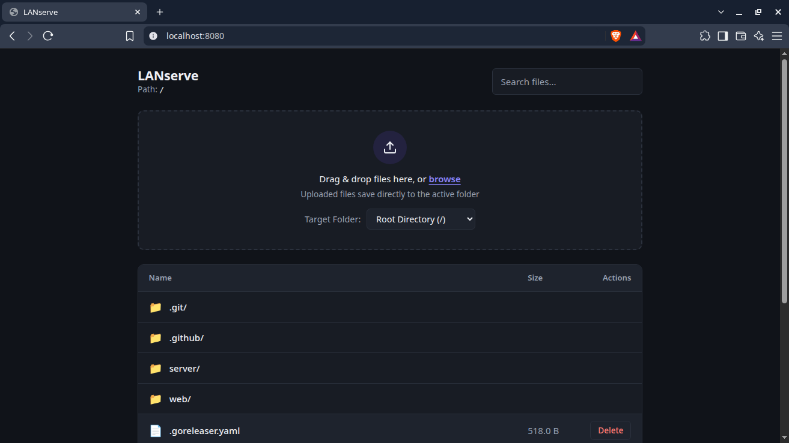

# LANserve

[](https://github.com/Dev-syphax/lanserve/releases/latest)
[](go.mod)
[](LICENSE)

A lightweight local file server with a browser UI. Browse, upload, and delete files over your WiFi from any device. One small binary, no dependencies, no config.



## Why LANserve?

`python -m http.server` can share a folder, but it can't take files back. LANserve adds uploads, deletes, and a UI that works well on a phone, and it ships as a single static binary, so there's nothing to install first.

## Features

- **Browse** files from any device on the same network
- **Upload** files from your browser
- **Delete** files from the UI
- **Optional access code** that protects uploads and deletes while browsing stays open
- **Single binary** for Linux, macOS, and Windows (AMD64 and ARM64), no runtime or dependencies

## Install

### Linux / macOS: install script

```bash
curl -fsSL https://raw.githubusercontent.com/Dev-syphax/lanserve/main/install.sh | bash
```

Prefer to read it first? [View the script](https://github.com/Dev-syphax/lanserve/blob/main/install.sh).

### Windows

1. Download `lanserve_<version>_windows_amd64.zip` (or `arm64`) from the [latest release](https://github.com/Dev-syphax/lanserve/releases/latest).
2. Extract it.
3. Run `lanserve.exe` from a terminal, or add its folder to your `PATH` to use `lanserve` anywhere.

### Download a binary manually

Grab the build for your system from the [latest release](https://github.com/Dev-syphax/lanserve/releases/latest):

| OS      | Architectures                        |
| ------- | ------------------------------------ |
| Linux   | AMD64, ARM64                         |
| macOS   | Intel (AMD64), Apple Silicon (ARM64) |
| Windows | AMD64, ARM64                         |

On Linux or macOS:

```bash
tar -xzf lanserve_<version>_<os>_<arch>.tar.gz
sudo mv lanserve /usr/local/bin/
```

Each release includes a `checksums.txt` so you can verify your download:

```bash
sha256sum -c checksums.txt --ignore-missing
```

### With Go

```bash
go install github.com/Dev-syphax/lanserve@latest
```

## Quick start

```bash
lanserve
```

Then open the printed URL in any browser on your network:

```
┌──────────────────────────────────────────────────────────┐
│    LANserve — Local File Server                          │
├──────────────────────────────────────────────────────────┤
│   Local:   http://localhost:8080                         │
│   Network: http://192.168.x.x:8080                       │
│   Serving: /your/current/directory                       │
│   Auth:    Disabled                                      │
└──────────────────────────────────────────────────────────┘
```

On your phone or another computer, use the **Network** address.

## Options

| Option   | Short | Default   | Description                     |
| -------- | ----- | --------- | ------------------------------- |
| `--port` | `-p`  | `8080`    | Port to listen on               |
| `--host` | n/a   | `0.0.0.0` | Address to bind to              |
| `--dir`  | `-d`  | `.`       | Directory to serve              |
| `--code` | `-c`  | none      | Access code for uploads/deletes |

## Examples

```bash
# Serve a specific folder
lanserve -d ~/shared

# Use a different port
lanserve -p 3000

# Only listen on this machine
lanserve --host 127.0.0.1

# Require a code for uploads and deletes
lanserve -d ./files -c my-secret-code

# Combine options
lanserve -d ~/Downloads -p 9000 -c my-secret-code
```

## Access code

By default, anyone on the network can browse, upload, and delete. To protect uploads and deletes, start LANserve with `--code`:

```bash
lanserve --code my-secret-code
```

Browsing stays open to everyone. The banner shows `Auth: Enabled` when a code is set.

## Security

LANserve is meant for **trusted local networks** (home, office, dev WiFi).

- Without `--code`, there is no authentication. Anyone on the network can browse, upload, and delete files.
- With `--code`, uploads and deletes need the code, but browsing is still open.
- Traffic is plain HTTP, so the access code can be seen by others on the network. It's a guard against accidents, not strong authentication.
- Passing the code with `--code` can leave it in your shell history and process list.
- Do **not** expose LANserve to the public internet.

To keep it limited to your own machine, use `--host 127.0.0.1`.

## Build from source

Requires [Go](https://go.dev/dl/) (developed with Go 1.26.5).

```bash
git clone https://github.com/Dev-syphax/lanserve.git
cd lanserve
go build -o lanserve .
./lanserve
```

## License

[MIT](LICENSE)
